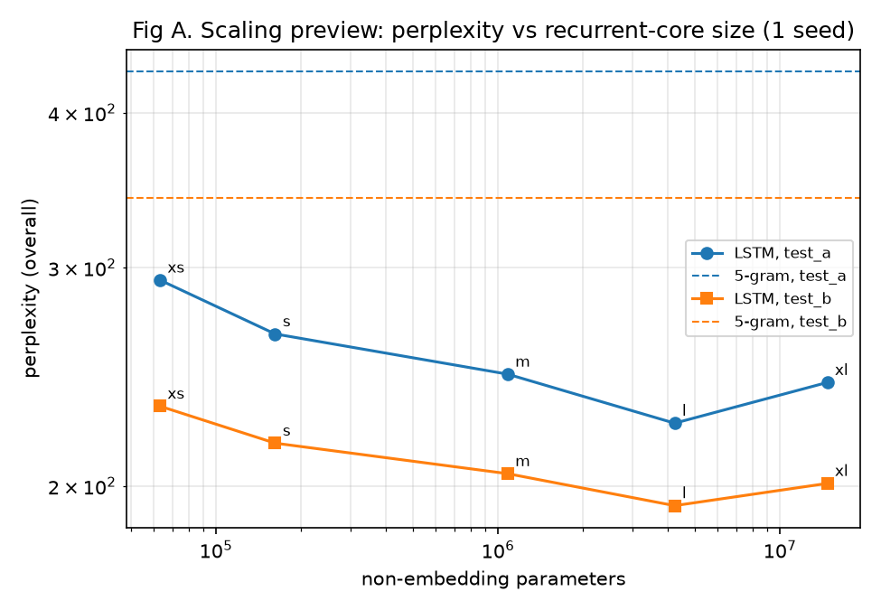
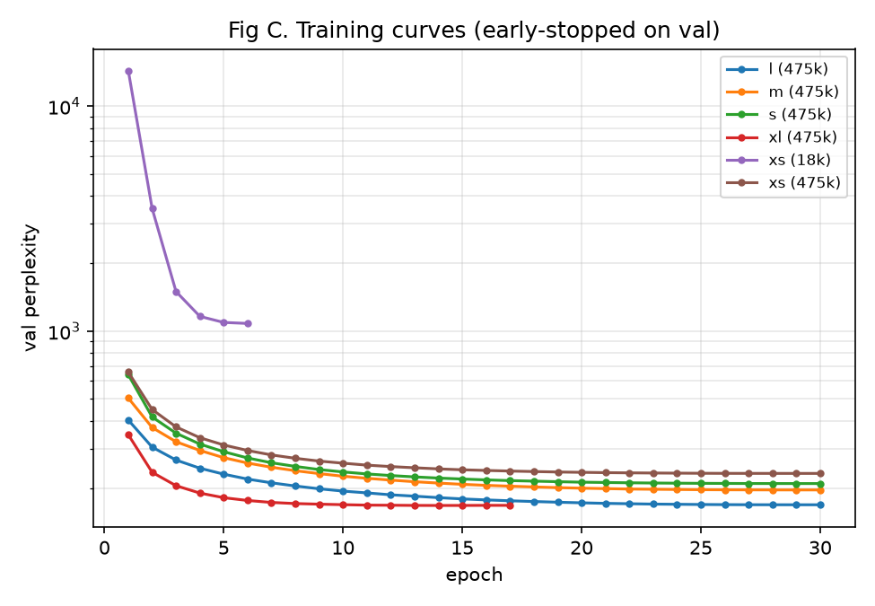
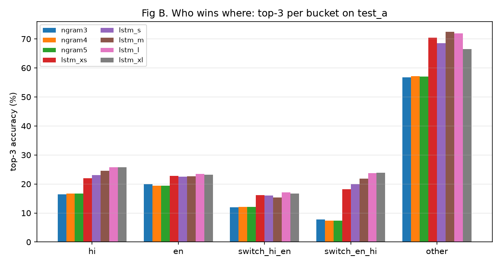
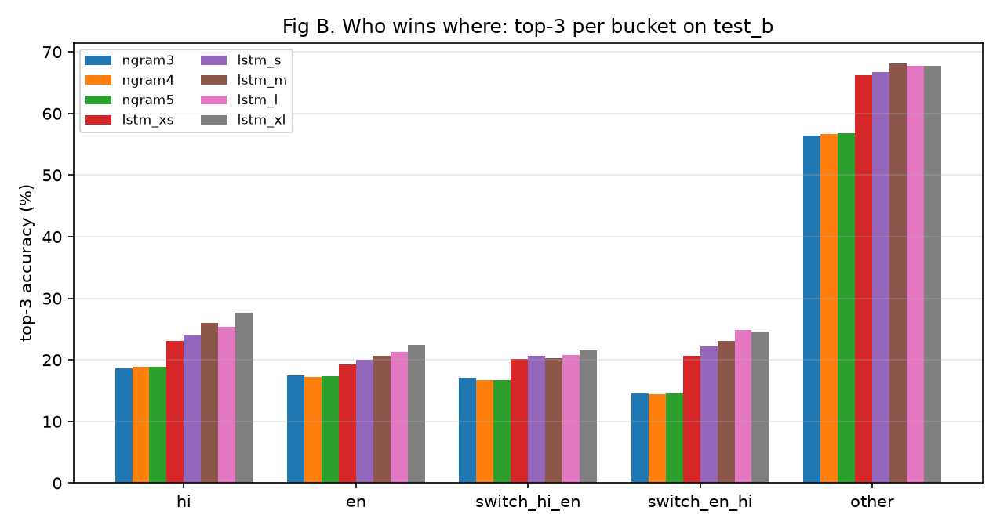
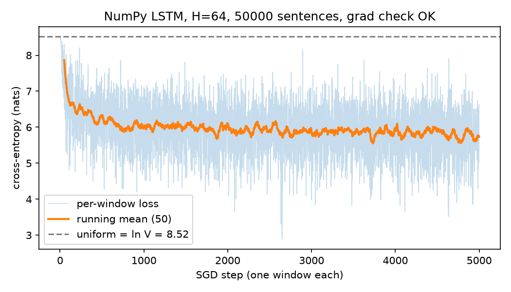

# Aage Batao

**Next-word autocomplete for Hinglish, the Hindi-English mix that people actually type.**

Type `kya kar raha` and it suggests **`hai`** (58 %). Press Tab to accept.

### ▶ [Try the live demo](https://aagebatao-965812381494.asia-south1.run.app)

<sub>Hosted on Google Cloud Run. It scales to zero, so the first load after a quiet spell takes a few seconds.</sub>

---

## What it does

Most keyboards handle Hindi or English but not both in one sentence. Hinglish switches language
mid-sentence (`kal movie dekhne chalein? it's so good yaar`), uses Roman script for Hindi, and has
no fixed spelling. Aage Batao ("tell me what's next") is a language model trained only on real
Roman-script Hinglish. It predicts the next word as you type.

The project compares three kinds of model on the same data and the same evaluation code:

| Model | What it is |
| --- | --- |
| **N-gram** (3, 4, 5-gram) | Modified Kneser-Ney via KenLM. The classic baseline. |
| **NumPy LSTM** | An LSTM written from scratch in NumPy with a hand-derived backward pass. Its gradients match PyTorch autograd exactly (differences around 1e-17). |
| **Word LSTM** (xs → xl) | A PyTorch LSTM language model in five sizes, 2M to 61M parameters. Size `m` runs the demo. |

## Results

On the chat test set, the word LSTM (`m`, 8.8M parameters) cuts perplexity by **43 %** compared with
the best n-gram, and nearly doubles top-1 accuracy. Lower perplexity is better; top-3 means the right word was among the three suggestions.

| Model | Params | Perplexity ↓ (chat) | Perplexity ↓ (social) | Top-3 accuracy (chat) | Top-3 accuracy (social) |
| --- | --- | --- | --- | --- | --- |
| 5-gram (KenLM) | n/a | 432.2 | 341.6 | 21.7 % | 29.2 % |
| LSTM xs | 2.0M | 293.1 | 231.9 | 28.6 % | 34.6 % |
| LSTM s | 4.0M | 265.2 | 216.5 | 28.9 % | 35.4 % |
| **LSTM m** (demo) | 8.8M | **246.1** | **204.6** | **30.4 %** | **36.7 %** |
| LSTM l | 19.6M | **224.7** | **192.8** | 31.4 % | 36.7 % |
| LSTM xl | 60.8M | 242.4 | 200.9 | 30.5 % | 37.7 % |

Top-1 accuracy on chat goes from 8.8 % (5-gram) to 16.4 % (LSTM m).

The 3, 4 and 5-gram models score within one perplexity point of each other. With 10M tokens of
tweets, longer contexts almost never repeat, so the higher orders fall back to trigrams.

**Speed:** the `m` model predicts in **2.6 ms** median, **3.7 ms** p95, on a laptop CPU (Apple M2).

### Bigger helps, until it doesn't



Perplexity falls steadily from `xs` to `l`, about 20 points for every 4× increase in parameters.
Then `xl` gets worse. It has the best validation score but memorises the training tweets and
generalises less well (training curves below). With this much data, `l` is the best size.



### Where the model wins: language switches

Each test token is labelled by language: Hindi, English, a switch from one to the other, or
other (punctuation, numbers, emoji). Breaking results down this way shows where the hard part of
Hinglish lies.



| Bucket (chat) | Share of tokens | 5-gram ppl | LSTM m ppl | 5-gram top-3 | LSTM m top-3 |
| --- | --- | --- | --- | --- | --- |
| Hindi | 43 % | 408 | 229 | 16.7 % | 24.5 % |
| English | 13 % | 1289 | 1158 | 19.4 % | 22.6 % |
| switch Hindi → English | 14 % | 3931 | 2575 | 12.1 % | 15.3 % |
| switch English → Hindi | 14 % | 663 | **174** | 7.4 % | **21.9 %** |
| other | 16 % | 22 | 15 | 57.0 % | 72.4 % |

- **English → Hindi** is the LSTM's biggest win. Once it has a few English words of context, it
  predicts the Hindi that follows nearly as well as plain Hindi.
- **Hindi → English** stays the hardest bucket for every model. Many of those English words are
  not in the 30k vocabulary at all (16 % unknown), so no model can predict them.



### The from-scratch LSTM learns

The NumPy LSTM, with every gradient derived by hand, trained on 50,000 real sentences. Its loss
falls from 7.87 to 5.74 nats (uniform guessing is 8.52).



## Data

**HingMix v0.1:** about 485k real Roman-script Hinglish sentences, 10.2M training tokens. No
synthetic data.

| Split | Sentences | Source | Genre |
| --- | --- | --- | --- |
| train | 458,621 | [L3Cube-HingCorpus](https://github.com/l3cube-pune/code-mixed-nlp) | tweets |
| val | 24,138 | L3Cube-HingCorpus | tweets |
| test (chat) | 766 | [CMU Hinglish DoG](https://huggingface.co/datasets/festvox/cmu_hinglish_dog) | movie chat |
| test (social) | 1,160 | [PHINC](https://zenodo.org/records/3605597) | social media |

Pipeline: normalise → tokenise → tag each word as Hindi or English with
[HingBERT-LID](https://github.com/l3cube-pune/code-mixed-nlp) → keep code-mixed messages, remove
foreign-language text → MinHash dedupe against the test sets → split. Vocabulary: the 30,000 most
frequent training words.

The two test sets come from different sources than the training data on purpose, so they measure
how well the model generalises beyond tweets. More detail is in the
[datasheet](data/hingmix/v0.1/DATASHEET.md).

## Run it yourself

The trained `m` checkpoint is in the repo, so the demo runs right after cloning:

```bash
git clone https://github.com/AaditJain11/AageBatao.git && cd AageBatao
make setup      # installs dependencies with uv
make demo       # open http://127.0.0.1:8000
```

To rebuild everything from the raw data:

```bash
make dataset                    # download, clean, tag, split
make ngram VERSION=v0.1         # n-gram baselines (needs KenLM's lmplz)
make train VERSION=v0.1 SIZE=m  # train an LSTM (xs, s, m, l, xl)
make summary VERSION=v0.1       # results table and figures
```

Training ran on a single Tesla T4, from 1 hour (`xs`) to 5 hours (`xl`).

## Model sizes

| Size | Embedding | Hidden | Layers | Params |
| --- | --- | --- | --- | --- |
| xs | 64 | 64 | 1 | 2.0M |
| s | 128 | 128 | 1 | 4.0M |
| m | 256 | 256 | 2 | 8.8M |
| l | 512 | 512 | 2 | 19.6M |
| xl | 512 | 1024 | 2 | 60.8M |

All sizes use AdamW, warmup then cosine decay, gradient clipping at 1.0, 64-token windows and
early stopping on validation perplexity. The full write-up, with every number traced to the file
that produced it, is in [reports/phase_01_baselines.md](reports/phase_01_baselines.md).

## Built with

PyTorch · NumPy · KenLM · FastAPI · Google Cloud Run

## Licence

The training data (L3Cube-HingCorpus) is CC BY-NC-SA 4.0, so models trained on it are for
non-commercial use. See [data/LICENSES.md](data/LICENSES.md) for every source.
